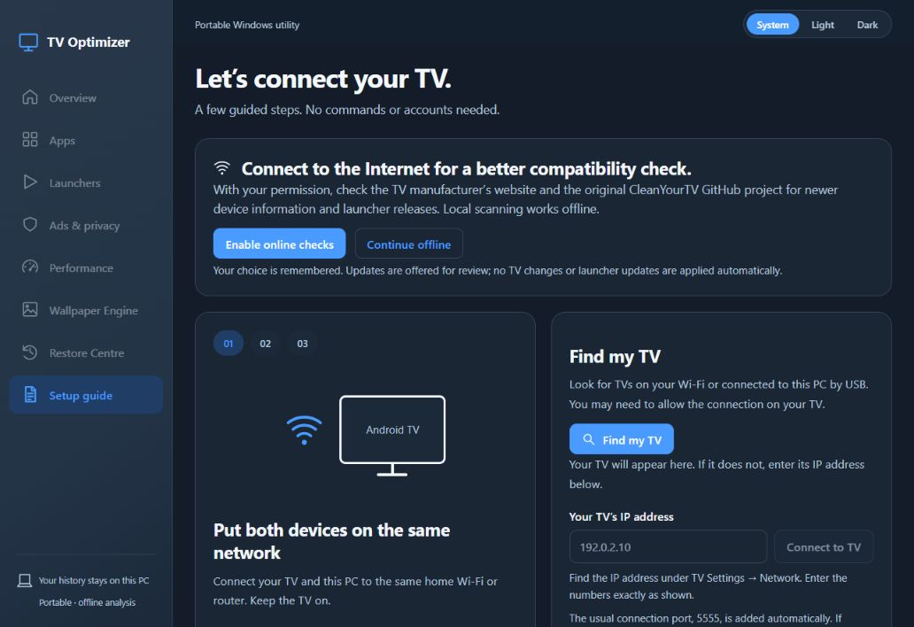
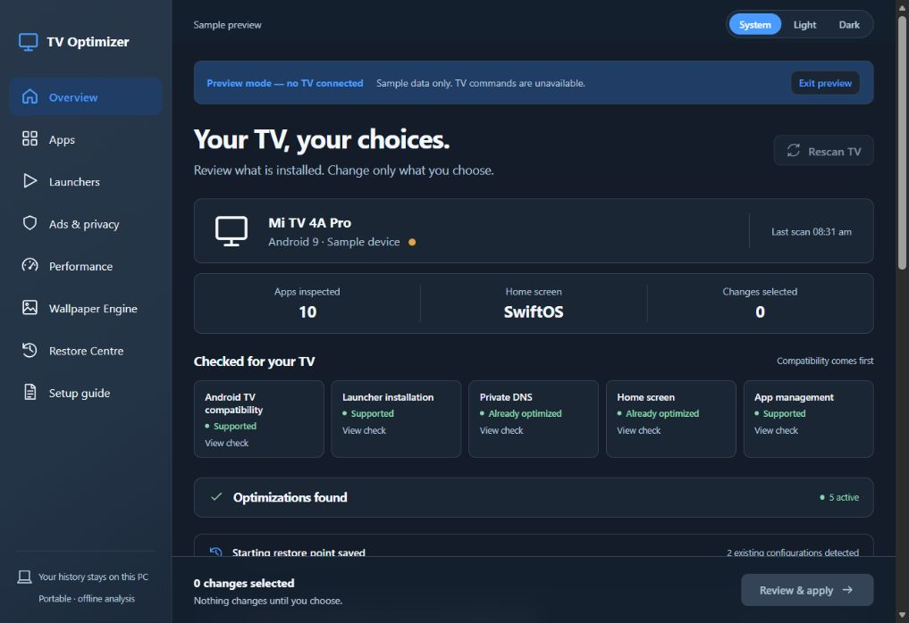

# TV Optimizer

**Created and maintained by [Soham Saha](https://github.com/Soham-Saha-AI).** TV Optimizer is an independent Android TV utility. Contributions are welcome through issues and pull requests; official releases are published by the maintainer.

**[Download TV Optimizer for Windows](https://github.com/Soham-Saha-AI/tv-optimizer/releases/latest/download/TV-Optimizer-0.1.0-SwiftOS-v3-Windows-x64.zip)** · [All releases](https://github.com/Soham-Saha-AI/tv-optimizer/releases)

**28 October portable update:** the native Windows release now builds successfully and all 63 native tests pass. This update includes the overview, confirmation-flow and Wallpaper Engine changes, plus SwiftOS v3 build24 with the unchanged tested build23 and build22 APKs retained. No Windows security settings were changed. See [portable update status](docs/PORTABLE-UPDATE-2026-10-28.md) and [Wallpaper Engine](docs/WALLPAPER-ENGINE.md).

A portable Windows utility to inspect an Android TV, explain compatible changes, and keep a restore point for each change. Processing and history stay on your computer. Recommendations are never selected automatically.

## Screenshots

Actual TV Optimizer interface. Overview uses built-in sample data; no personal TV connection or history is shown.

## Easy to use — no AI app needed

You do not need an AI application, AI account, coding skills, or an Android SDK to optimize your TV. TV Optimizer is a guided Windows app with plain-language instructions. It performs local, rule-based checks against the connected TV's model, firmware and capabilities; it does not call AI services. Online checks are separate and optional, and the app asks before enabling them.

Its specialty is careful, reversible Android TV maintenance: each suggestion explains the impact and restore limits, nothing is selected automatically, and the app checks current device state before applying a change.

## What each tab does

- **Setup guide:** explains debugging and pairing, discovers TVs over USB or supported local-network methods, lets you enter an address manually, and asks you to confirm the detected model before scanning.
- **Overview:** summarizes what the scan found, separates available recommendations from optimizations already present, and displays TV-specific compatibility results.
- **Apps:** lists installed apps, their state and purpose; supports only reviewed disable/restore or uninstall choices, while protecting essential services and leaving unknown apps for manual review.
- **Launchers:** manages Google Home, Xiaomi PatchWall, original CleanYourTV and SwiftOS separately. Home changes use a recovery timer and require you to confirm that the TV remote and new Home work.
- **Ads & privacy:** offers reviewed DNS protection levels and lets you inspect supported analytics, feedback and advertising services individually. DNS changes are checked and can be restored if the connection check fails.
- **Performance:** shows available memory and storage, offers system animation timing, closes a selected downloaded app, and clears rebuildable cache. It explains that these actions do not guarantee a faster TV or more free RAM.
- **Wallpaper Engine:** prepares and reviews photo transfers, validates image size and transfer checksums, and manages local weather/time wallpaper files without silently enabling Auto wallpaper.
- **Restore Centre:** records changes and starting state on the PC, supports reviewed reversals and session restore, imports/exports recovery JSON, and stores your own physical remote/playback checks.

The separate help and documentation explain compatibility and restoration. Analysis and history stay on the PC. The portable bundle includes the required Windows runtime and ADB; users do not need to install Python, Java, Rust, Node.js or Android SDK just to run it.

## Testing status — read before use

Testing is limited and device-specific. The 28 October Windows source update passes 63 native Rust tests and the TypeScript/Vite release build. Earlier frontend checks passed 23 tests and isolated browser flows. SwiftOS build 24 passed 257 Android JVM tests, release lint, R8, signer continuity, and bounded wallpaper checks on one Mi TV model. The updated Windows package has not been validated on a clean Windows VM, and this source-package update did not repeat TV tests. Long-duration playback and several physical remote-button checks remain incomplete. Compatibility on other TV models and firmware is not established by these results.

Use the documented compatibility checks, keep a restore point, and review each operation. Back up anything important before changing TV settings. Performance, remote behavior and app compatibility can differ by model, firmware, installed apps and network configuration.

## Help test and improve it

Please test on your Android TV and help improve the project. Open an issue with the TV manufacturer/model, Android version, firmware/build, TV Optimizer version, steps to reproduce, and expected versus actual behavior. Do not post serial numbers, private IP addresses, Wi-Fi details, TV history exports, account data or personal photos. Pull requests for compatibility fixes, documentation and safer workflows are welcome. The maintainer reviews and publishes official releases.

## Open the portable app

1. Extract the **entire ZIP** into a folder you can write to, such as Documents or a USB drive. Do not run the executable inside the ZIP.
2. Open **TV Optimizer.exe**. Keep `tools`, `launchers`, `runtime`, and `data` beside it.
3. Choose **Enable online checks** for a better compatibility check, or **Continue offline**. Online access is off until accepted and your choice is remembered.
4. Follow **Setup guide** on your TV: enable developer/debugging options and accept the computer's trust prompt. Both devices must be on the same local network.
5. Select **Find my TV**, or enter its IP address (for example `192.0.2.10`; the usual port is filled in automatically). When several devices are found, choose the one to scan, then confirm the detected model. Compatibility is checked before recommendations appear.
6. Read an item's impact and restore explanation. Choose only the changes you want, review, then apply.

The bundle contains the Windows runtime, ADB, offline rules and SwiftOS. Scanning and SwiftOS need no Python, Java, Rust, Node.js or Android SDK installed on the user's PC. Internet access is needed for public DNS and streaming, but analysis and SwiftOS installation are local.

**Get latest CleanYourTV** is optional. The upstream project publishes source code, so the app downloads the stable release, prepares Java/Android build tools, builds it in the background, and verifies its package identity, Android requirements, SHA-256 and APK signature. First use downloads several hundred MB and needs one explicit agreement to Google's Android SDK terms. Build tools and a local signing key stay under `data/original-builder`; keep this folder for compatible future updates. A separate application ID lets the original Home coexist with SwiftOS. Preparation changes no TV settings; review installation, then choose preferred Home separately.

## Your choices

- Switch between light, dark and system appearance. Visual effects stop at rest and respect reduced motion.
- Use the normal Windows minimize, maximize and close controls. Decorative macOS traffic-light buttons are not part of the interface.
- Keep or disable Google Home and Xiaomi PatchWall independently. Choose original CleanYourTV or **SwiftOS** (internally SS OS), our custom Liquid Glass launcher, as preferred Home. Installing a launcher never changes preferred Home automatically.
- A guarded Home switch uses a detached recovery timer on the TV. Press Home on the remote and confirm within the displayed period. Without confirmation the previous Home returns. The timer cannot survive TV power loss.
- On compatible Xiaomi firmware, Google Home's priority may prevent a switch. **Replace Google Home** is a separate, explicit choice that includes its state in recovery.
- Known analytics and feedback packages can be disabled individually. Essential system, network, input, DRM, casting, voice and update services are protected. Unknown services are not guessed safe from their names.
- Each app shows a short **Used for** note before disable or uninstall and again during review. Unknown purposes are labelled explicitly. Uninstall first opens a warning and requires confirmation to add it to the review basket. Already-disabled apps show that removal may bring no further speed or RAM benefit; data, sign-in and storage limits stay visible.
- Animation changes adjust transition duration. They do not make the processor faster. Closing an app is temporary; Android remains responsible for memory management.

## DNS protection levels

| Choice | Typical use | What to consider |
|---|---|---|
| AdGuard | A straightforward starting point for known ad and tracker domains | Some apps can still need blocked domains. |
| HaGeZi Pro | Balanced stronger privacy filtering | Low to moderate breakage risk; test streaming and sign-in. |
| HaGeZi Pro++ | Stronger filtering for users willing to troubleshoot | Moderate breakage risk; account and content features may fail. |
| HaGeZi Ultimate | Aggressive filtering with frequent app checks | High breakage risk. Choose deliberately and keep Restore available. |

Exactly one public DNS provider is active at a time. These profiles have no per-TV allowlist. They cannot remove advertising served from the same domain as video content or guarantee removal of every sponsored row. The app verifies the TV's connection and restores previous DNS when its checks fail. A working network test still does not prove every streaming app works; use the guided playback checklist.

Provider hostnames and severity descriptions are based on the [HaGeZi project](https://github.com/hagezi/dns-blocklists#controld) and [AdGuard DNS](https://adguard-dns.io/en/public-dns.html).

## Restore and recovery

Open **Restore Centre** to undo an individual recorded change or reverse a session. The original default/enabled state, selected TV user, firmware and setting values are preserved. A restore stops if the connected TV or its current state differs from the record, protecting later manual changes.

The first eligible scan automatically saves a **starting restore point** on this PC before any change. Later scans never replace it. It includes the states already present on your TV: disabled or removed apps, recognized DNS filtering, reduced animations and a custom preferred Home where detected. Their earlier origins and values remain unknown.

**Restore all** reviews this portable copy's recorded changes since that starting point, then reverses supported changes in dependency order. Pre-existing optimizations are preserved. It stops for a conflicting manual change or firmware change and lists operations with no complete Undo, including cache cleanup, temporary process closing and launcher updates. Private app data cannot be recreated. Imported older history remains individually restorable; it does not replace the local starting point or silently enter Restore all. Keep the portable `data` folder with the app.

Disabling retains app installation and data. Removing a system app for one user leaves its factory APK in the system image. Uninstalling a downloaded app requires complete verified APK backups. Private app data, sign-ins, removed updates and deleted caches are not guaranteed recoverable. Cache cleanup has no Undo.

Keep the `data` folder: it contains SQLite history, before-images, APK backups and exported reports. The TV also receives a minimal record before a change. JSON exports are local diagnostic/recovery records, not a full firmware or private app-data backup. Import accepts this application's schema and matching TV/firmware only; it never executes imported shell scripts.

Use **Choose file** in Restore Centre to import a recovery JSON export. No full file path needs to be typed. After an interrupted operation, scanning compares the TV with the recorded states. It never retries a command automatically; unknown or conflicting results require review.

Pre-existing optimizations have an unknown original baseline unless a validated recovery record exists. Do not assume a generic Android default equals your TV's previous value.

## Compatibility

The initial validated profile is one Android 9 TV. Generic settings and recognized optional app toggles are offered on other devices when the initial read-only capability checks succeed. Firmware-specific operations stay gated by their profile. A command being available is not the same as physical playback or remote validation; the app distinguishes those checks.

SwiftOS and the original CleanYourTV launcher are Android applications requiring Android TV / Google TV 8 or later. They cannot run on Samsung Tizen, LG webOS or other non-Android operating systems. API compatibility does not establish remote/startup compatibility on an untested TV. Use the physical checklist for Home, Back, D-pad, OK, volume hold, microphone, inputs, standby/wake and streaming.

After a scan, the optional **Check manufacturer information online** control reads reviewed official company domains using this PC's Internet connection. It displays source links and whether the page matches the model. Website text never becomes a command or automatically unlocks an optimization. The TV's observed firmware and actual remote checks remain authoritative.

The Internet choice stays in **Overview** as well as Setup. With online access accepted, CleanYourTV community references refresh on startup, Internet reconnection, and daily while open. Official manufacturer information is checked in the background after a confirmed scan. The last successful database is retained offline. Newer CleanYourTV releases are offered to existing users; installation is never automatic. Community reports are references: new package-removal commands are never imported or run automatically. The offline rules remain the authority for executable operations.

**Also check the full user manual** is an additional optional test for remote-button behavior. It starts unselected. The Mi TV 4A Pro 49 reference was reviewed across all nine pages, including its remote diagram; the app checks the current PDF against the reviewed hash. A changed manual or an unreviewed model remains incomplete. The manual and product page disagree on RAM, so the manual is not treated as an exact hardware match. Documented button behavior is separate from the physical checks in Restore Centre. The copyrighted manual itself is not redistributed.

Find my TV combines USB, supported wireless discovery and a bounded search of the standard ADB port on the PC's private network. Guest-network isolation, VPN routing or a larger subnet can prevent discovery; entering the TV's plain IP remains available. Pairing on newer TVs uses the separate address and port shown by Wireless debugging.

See `docs/` for build and validation records. No credentials or private launcher signing key are included in the portable package.
